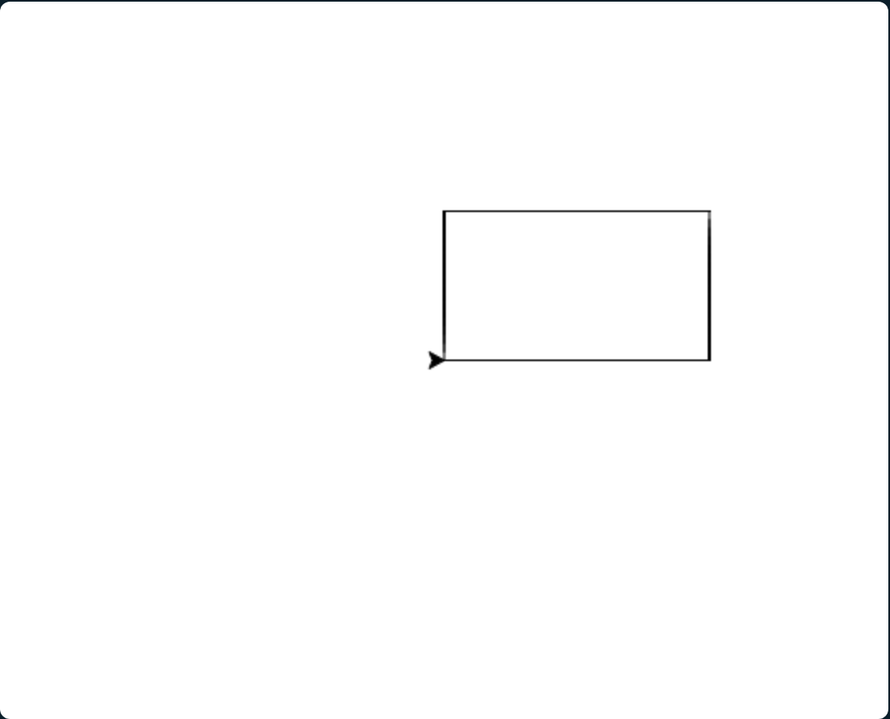
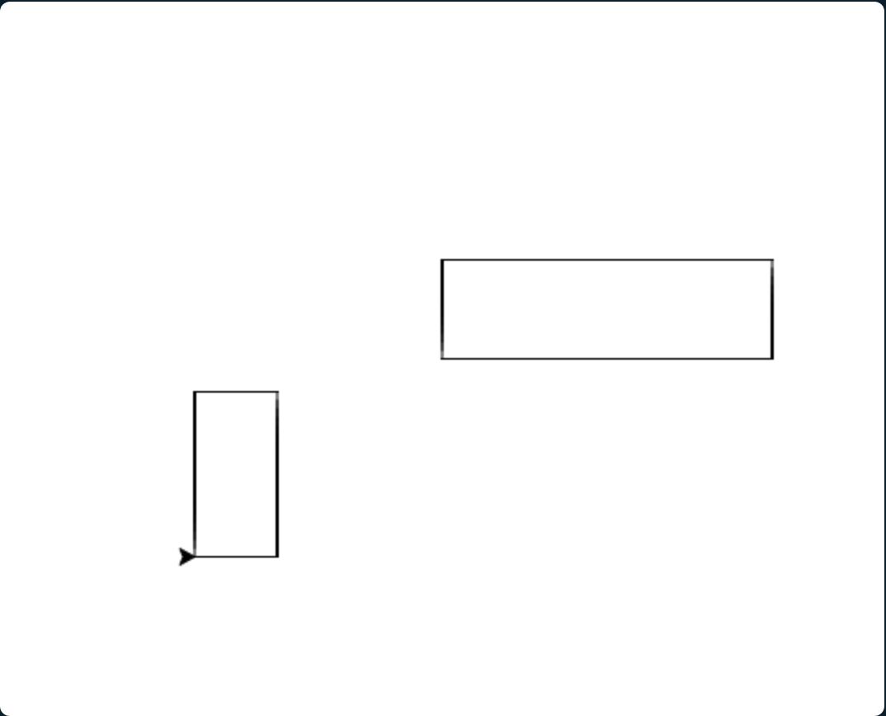

# Des fonctions
<!-- ws:
cover:
  media: img/rectangles.png
  tagline: "Donne un nom à tes lignes, et la tortue dessine un rectangle sur commande."
-->

Pour le carré, tu as écrit quatre fois les mêmes deux lignes. Pour un dessin plus riche, il
faudra plusieurs rectangles, et tu ne vas pas les écrire côté par côté. Une **fonction**,
c'est un groupe d'instructions auquel tu donnes un nom, pour l'exécuter autant de fois que tu
veux en l'appelant par ce nom. Tu en connais déjà : `forward`, `left` et `circle` sont des
fonctions que quelqu'un a écrites pour toi. Dans cette partie, tu vas écrire tes propres
fonctions.

## Un rectangle en une commande
<!-- ws: {type: exercise, id: fonction, points: 65, validation: quiz} -->

Efface tout le programme de l'éditeur sauf sa première ligne, `from turtle import *`.

<!-- ws:toolbox -->
### Boîte à outils

> 🧰 **Outil : `def` « définit une fonction »**
> `def`, un nom, des parenthèses, deux-points : puis les instructions de la fonction,
> décalées de quatre espaces. Ce décalage dit où la fonction commence et où elle finit.
>
> ```python
> def saluer():
>     print("Bonjour !")
>     print("Bienvenue.")
> ```
>
> Définir une fonction ne l'exécute pas : le programme la retient, c'est tout.

> 🧰 **Outil : appeler une fonction**
> Son nom, suivi de parenthèses. Chaque appel exécute toutes ses instructions.
>
> ```python
> saluer()
> saluer()     # affiche les deux lignes une deuxième fois
> ```
>
> L'appel s'écrit **après** la définition, et sans décalage : il est en dehors de la fonction.
<!-- /ws:toolbox -->

### Mise en application
<!-- ws:doit -->

Ton objectif : définir une fonction `rectangle()` qui dessine un rectangle de 160 pas de
large et 90 pas de haut, là où se trouve la tortue. Puis appelle cette fonction, pour
l'utiliser.

Tu dois obtenir ceci :



<!-- ws: {type: hint} -->
<details><summary>Un indice ?</summary>

À l'intérieur de la fonction, c'est ton carré avec deux longueurs différentes : la largeur,
puis la hauteur, puis la largeur, puis la hauteur.

</details>

<!-- ws: {type: quiz, id: mot-cle, title: "Le mot-clé", kind: single} -->
> Quel mot-clé commence la définition d'une fonction en Python ?
- A. `def`
- B. `function`
- C. `fonction`
- D. `call`

<!-- ws: {type: quiz, id: decalage, title: "Le décalage", kind: single} -->
> Dans une fonction, à quoi sert le décalage de quatre espaces devant les instructions ?
- A. Il indique quelles instructions font partie de la fonction
- B. Il rend le programme plus lisible, sans autre effet
- C. Il ralentit la tortue entre deux instructions
- D. Il remplace les parenthèses de l'appel

## Un rectangle de n'importe quelle taille
<!-- ws: {type: exercise, id: arguments, points: 55} -->

Ta fonction dessine toujours le même rectangle. Pour un dessin, il en faut souvent plusieurs,
de tailles différentes. Plutôt qu'une fonction par taille, une seule, à qui tu dis la taille
au moment de l'appel.

<!-- ws:toolbox -->
### Boîte à outils

> 🧰 **Outil : une fonction avec des arguments**
> Entre les parenthèses de `def`, des noms séparés par des virgules. Dans la fonction, chaque
> nom vaut ce que l'appel a donné. C'est exactement ce que fait `forward(100)` : `100` est
> l'argument.
>
> ```python
> def addition(a, b):
>     print(a + b)
>
> addition(2, 3)      # affiche 5
> addition(10, 20)    # affiche 30
> ```
>
> Le nombre de valeurs à l'appel doit être celui des noms dans le `def`, et dans le même
> ordre.
<!-- /ws:toolbox -->

### Mise en application
<!-- ws:doit -->

Ton objectif : ta fonction devient `rectangle(largeur, hauteur)` et dessine un rectangle de la
taille demandée, là où se trouve la tortue. Modifie aussi l'appel de l'étape précédente :
`rectangle()` sans valeurs ne marche plus, il lui faut maintenant une largeur et une hauteur.
Appelle-la deux fois, avec deux tailles différentes, à deux endroits différents.

Voici par exemple ce que ça peut donner :



<!-- ws: {type: hint} -->
<details><summary>Un indice ?</summary>

Dans la fonction, remplace les deux nombres par les deux noms des arguments. Pour changer
d'endroit entre les deux appels, tu connais `penup()` et `setpos(x, y)`.

</details>
