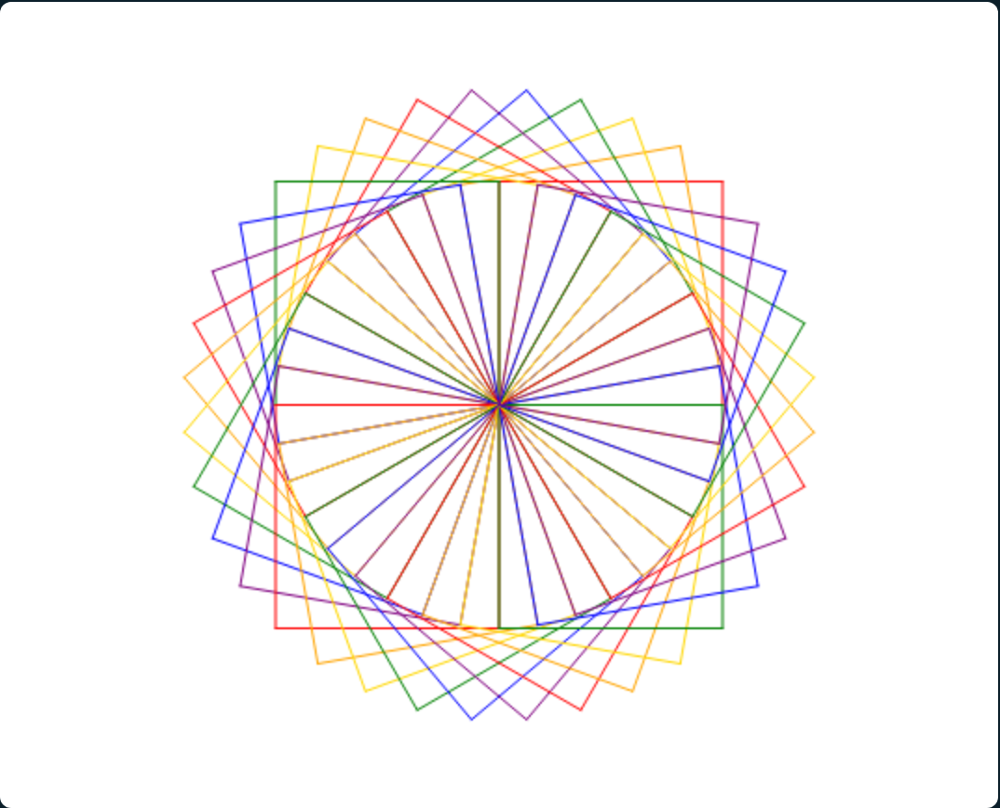

# Dessine avec la tortue

Une tortue est posée au milieu de l'écran. Elle ne sait faire que trois choses : avancer,
tourner, et laisser une trace derrière elle. Avec ces trois ordres, et quelques autres que tu
découvriras en route, tu vas lui faire dessiner ce que tu veux.

