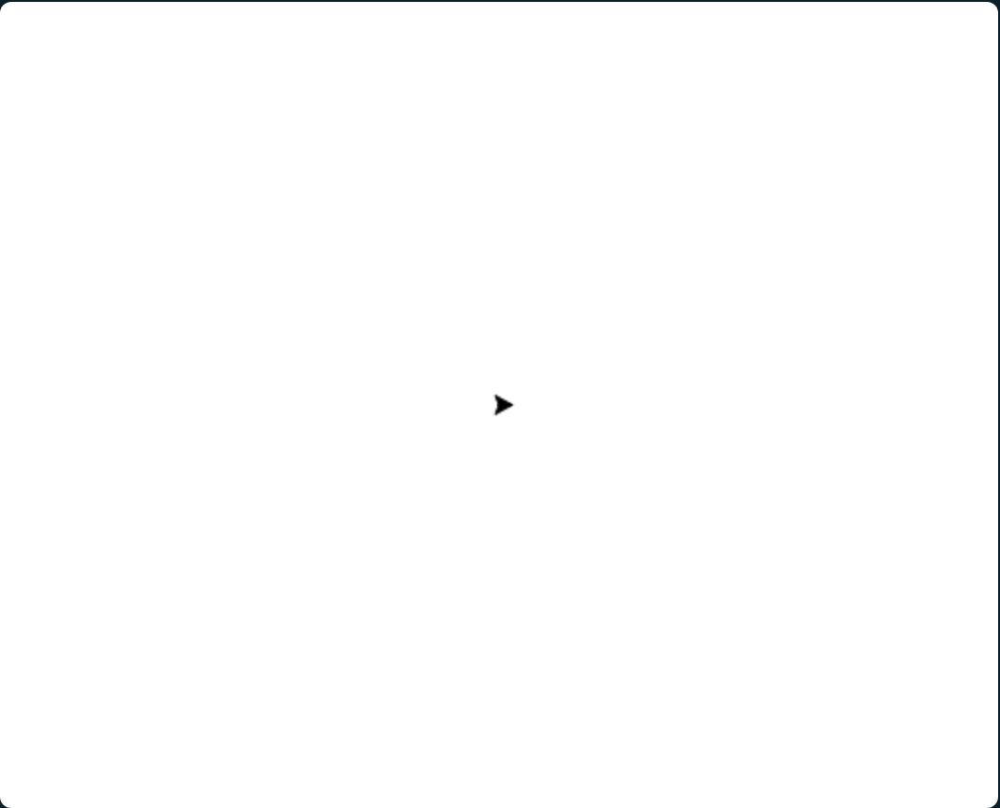
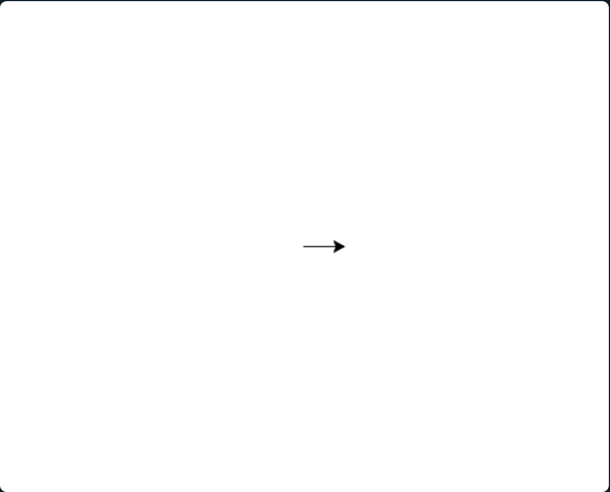
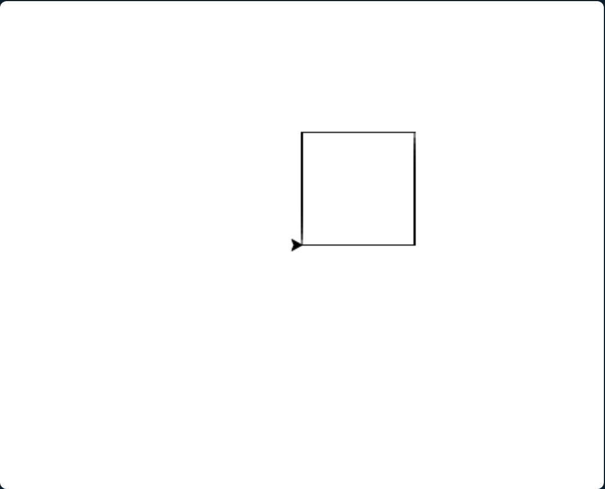
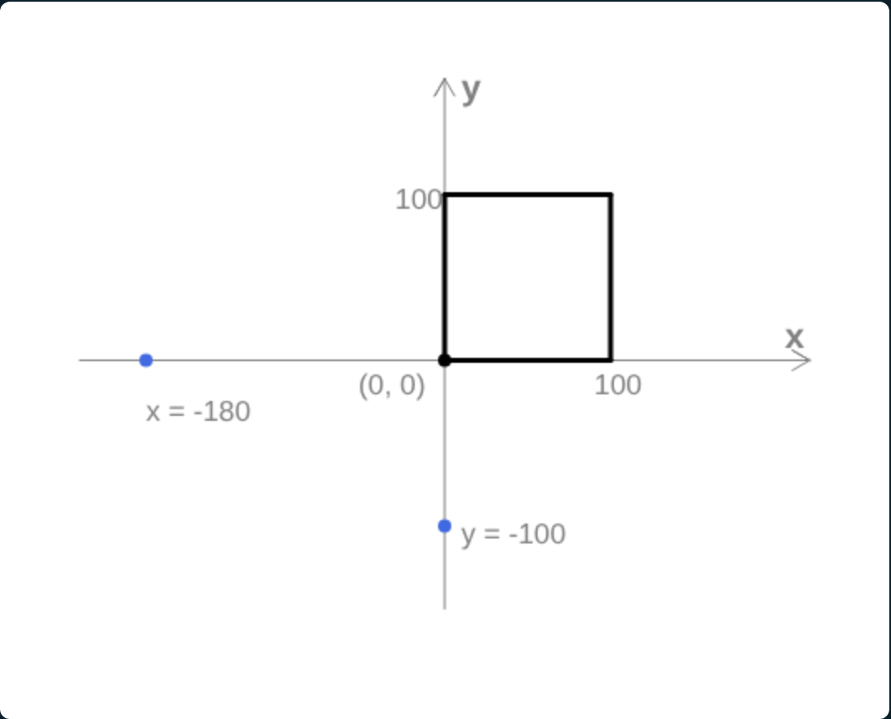
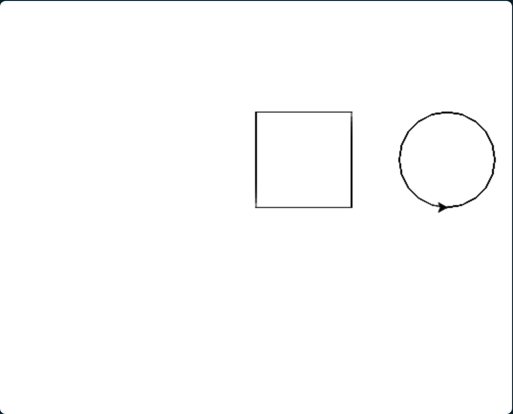

# Premiers traits
<!-- ws:
cover:
  media: img/carre-rond.png
  tagline: "Avancer, tourner, lever le stylo : la tortue t'obéit au doigt et à l'œil."
-->

La tortue part du centre de l'écran. Elle avance quand on lui dit d'avancer, et elle laisse
une trace derrière elle.

## Lance la tortue
<!-- ws: {type: exercise, id: lancer, points: 20, validation: quiz} -->
<!-- étape de modelage : le code est donné volontairement -->

Commence par prendre en main l'environnement de l'atelier.

<!-- ws:toolbox -->
### Boîte à outils

> 🧰 **Outil : `forward(n)` « avance »**
> `forward` est une **fonction** : un ordre que la tortue sait exécuter. Le nombre entre
> parenthèses est son **argument** : il précise de combien avancer. `forward(100)` avance de
> 100 pas, `forward(20)` de 20.
> La première ligne, `from turtle import *`, donne au programme toutes les fonctions de la
> tortue. Elle reste en haut de chaque programme de cet atelier.
<!-- /ws:toolbox -->

### Mise en application
<!-- ws:doit -->

1. Clique sur le bouton **Ouvrir Tortue** : l'éditeur s'ouvre à côté des instructions.
   <!-- ws:cue runtime -->
2. Un programme de deux lignes est déjà écrit dans l'éditeur :

   ```python
   from turtle import *
   forward(100)
   ```

3. Clique sur **▶ Lancer**, et regarde la tortue.



<!-- ws: {type: quiz, id: direction, title: "La direction", kind: single} -->
> Après avoir lancé le code qui t'a été donné, dans quelle direction est allée la tortue ?
- A. Vers la gauche
- B. Vers la droite
- C. Vers le haut
- D. Vers le bas

## Tourne
<!-- ws: {type: exercise, id: tourner, points: 30, validation: quiz} -->

Avancer ne suffit pas : il faut aussi tourner. Après ton `forward(100)`, fais tourner la
tortue vers la gauche d'un quart de tour, puis fais-la avancer à nouveau de 100 pas. Ensuite,
fais-la tourner vers la droite d'un quart de tour, et avancer encore de 100 pas.

<!-- ws:toolbox -->
### Boîte à outils

> 🧰 **Outil : `left(a)` et `right(a)` « tourne »**
> La tortue pivote sur place de `a` degrés, vers la gauche ou vers la droite, sans avancer.
> `left(90)` est un quart de tour, `left(180)` un demi-tour, `left(360)` un tour complet.
<!-- /ws:toolbox -->

<!-- ws:glossary -->
### Vocabulaire

| Terme | Signification |
| --- | --- |
| `degré` | unité d'angle : un tour complet fait 360 degrés |
| `pas` | unité de distance de la tortue, environ un pixel |
<!-- /ws:glossary -->

### Mise en application
<!-- ws:doit -->

Écris le code qui te permet d'obtenir ceci :



<!-- ws: {type: quiz, id: quart-de-tour, title: "Le quart de tour", kind: single} -->
> La tortue regarde vers la droite. Après `left(90)`, vers où regarde-t-elle ?
- A. Vers le haut
- B. Vers le bas
- C. Vers la gauche
- D. Toujours vers la droite

<!-- ws: {type: quiz, id: demi-tour, title: "Le demi-tour", kind: single} -->
> Quelle instruction fait faire demi-tour à la tortue, sans qu'elle avance ?
- A. `forward(180)`
- B. `left(180)`
- C. `right(90)`
- D. `left(90)`

## Un carré
<!-- ws: {type: exercise, id: carre, points: 20} -->

Tu sais maintenant avancer et tourner. Prochaine étape : dessiner un carré. Avant de
commencer, efface tout le programme de l'éditeur sauf sa première ligne,
`from turtle import *`.

### Mise en application
<!-- ws:doit -->

Ton objectif : la tortue dessine un carré de 100 pas de côté, et revient à son point de
départ.

Tu dois obtenir ceci :



<!-- ws: {type: hint} -->
<details><summary>Un indice ?</summary>

Un carré, c'est quatre côtés de la même longueur, et quatre coins identiques. Compte les
`forward` et les virages dont tu as besoin.

</details>

## Un rond à côté du carré
<!-- ws: {type: exercise, id: rond, points: 40} -->

La tortue se déplace dans un repère. Elle commence au centre de l'écran, au point `(0, 0)`,
et `setpos(x, y)` te permet de changer sa position dans ce repère.



<!-- ws:toolbox -->
### Boîte à outils

> 🧰 **Outil : `penup()` et `pendown()` « lève et pose le stylo »**
> Stylo levé, la tortue se déplace sans tracer. Stylo posé, elle trace à nouveau. Au départ,
> le stylo est posé.
>
> ```python
> penup()
> forward(50)     # se déplace, ne trace rien
> pendown()
> forward(50)     # trace
> ```

> 🧰 **Outil : `setpos(x, y)` « va au point »**
> La tortue va directement au point de coordonnées `(x, y)`, en ligne droite, en traçant si
> le stylo est posé.
>
> ```python
> penup()
> setpos(-80, 40)   # 80 pas à gauche du centre, 40 pas au-dessus
> pendown()
> ```

> 🧰 **Outil : `circle(r)` « dessine un cercle »**
> La tortue dessine un cercle de rayon `r`. Le cercle se dessine **à sa gauche** : si elle
> regarde vers la droite, le cercle est au-dessus d'elle, et elle en est le point le plus bas.
>
> ```python
> circle(30)
> ```
<!-- /ws:toolbox -->

### Mise en application
<!-- ws:doit -->

Ton objectif : après ton carré, la tortue dessine un cercle de rayon 50 à côté du carré,
sans qu'aucun trait ne relie les deux.

Tu dois obtenir ceci :



<!-- ws: {type: hint} -->
<details><summary>Un indice ?</summary>

La tortue trace tant que le stylo est posé. Lève-le avant de te déplacer, et pose-le avant
de dessiner le cercle.

</details>
