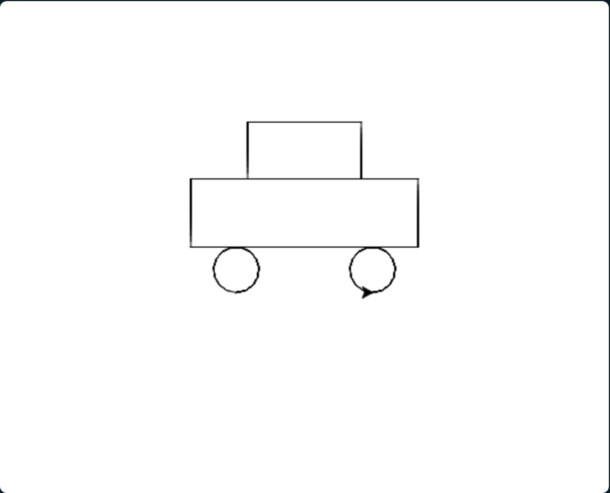
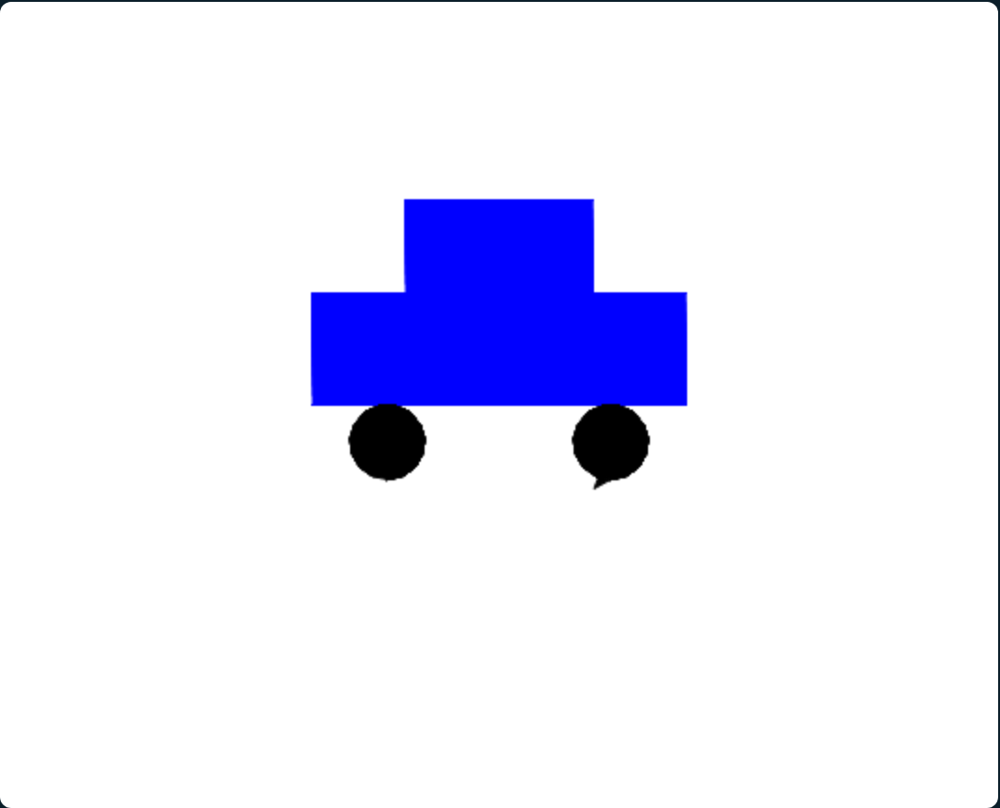
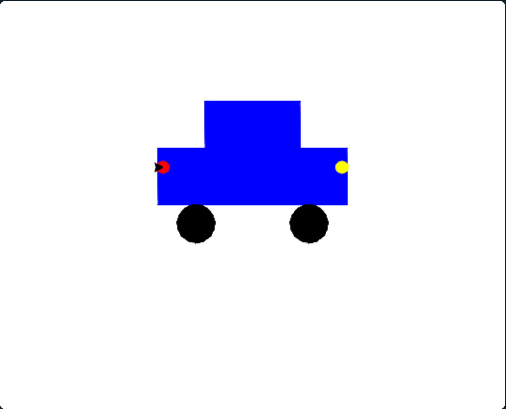
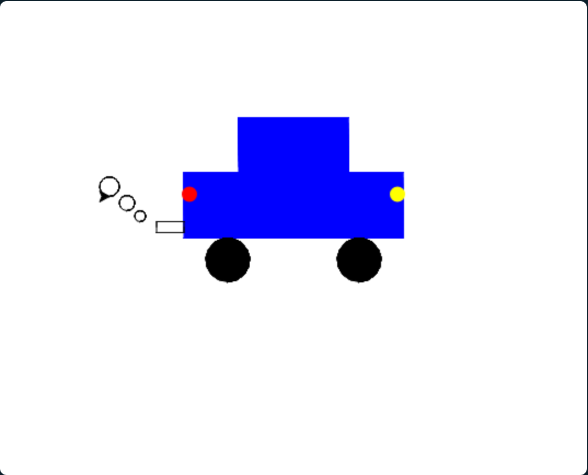
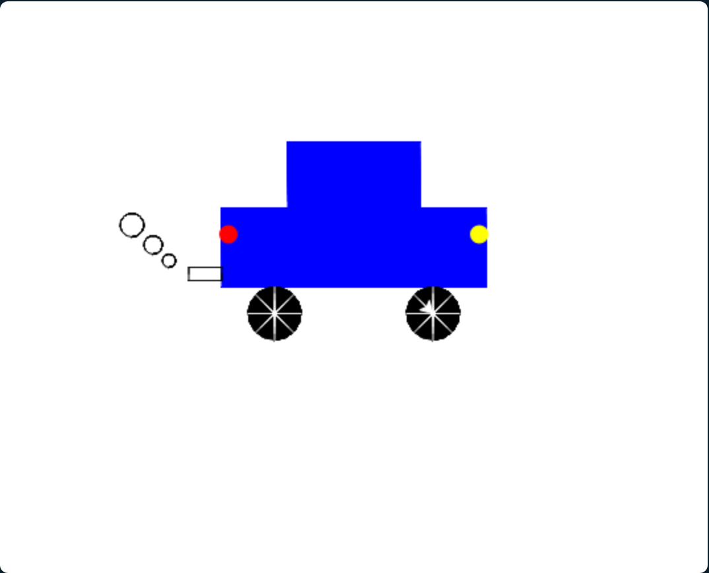
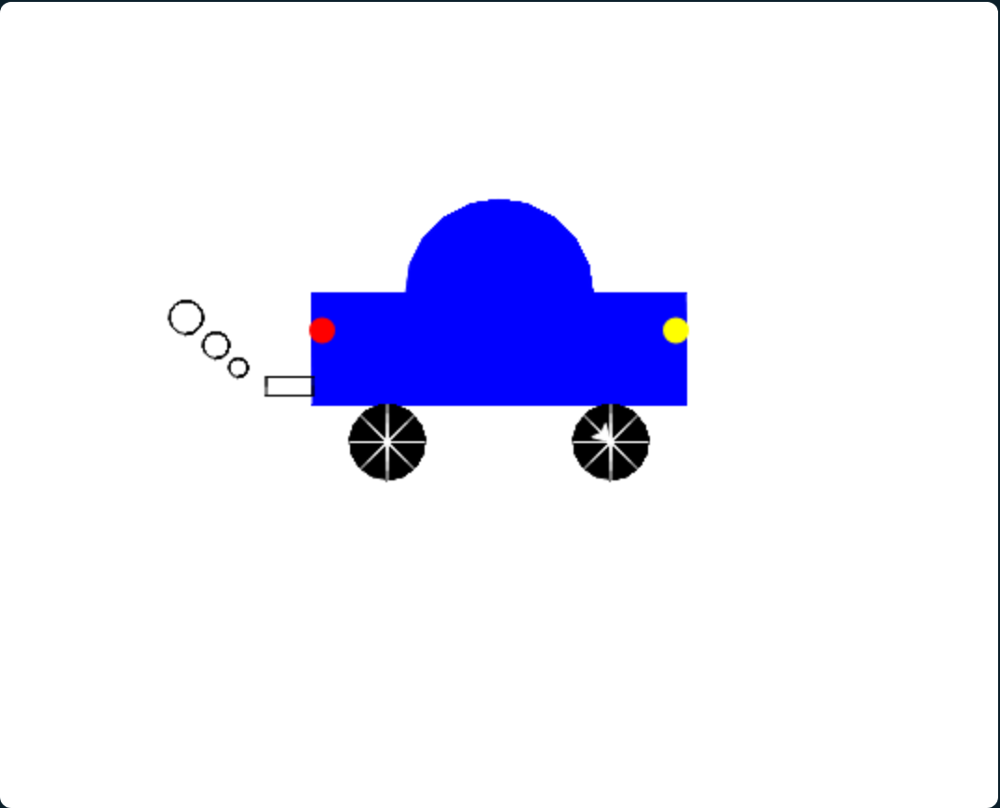

# La voiture
<!-- ws:
cover:
  media: img/voiture.png
  tagline: "Deux rectangles, deux ronds : ta fonction fait le gros du travail."
-->

Tu as tout ce qu'il faut : une fonction qui dessine un rectangle de la taille que tu veux, et
la tortue sait faire des ronds et se déplacer sans tracer.

## Dessine une voiture
<!-- ws: {type: exercise, id: voiture, points: 85} -->

Tu as déjà tous les outils à disposition. Garde la définition de ta fonction
`rectangle(largeur, hauteur)`, et efface tout ce qui vient en dessous.

<!-- ws:toolbox -->
### Boîte à outils

> 🧰 **Rappel : où se dessine un rond ?**
> `circle(r)` dessine le rond **à gauche** de la tortue. Tortue tournée vers la droite, le
> rond est au-dessus d'elle : pour poser une roue sous la carrosserie, place la tortue au
> point le plus bas de la roue.
>
> ```python
> penup()
> setpos(40, -60)   # le bas de la roue
> pendown()
> circle(20)        # son centre est en (40, -40)
> ```
<!-- /ws:toolbox -->

### Mise en application
<!-- ws:doit -->

Ton objectif : une voiture de profil, faite de deux rectangles, la carrosserie et l'habitacle,
et de deux ronds, les roues. Ta fonction `rectangle(largeur, hauteur)` dessine les
rectangles.

Voici par exemple ce que ça peut donner :



<!-- ws: {type: hint} -->
<details><summary>Un indice ?</summary>

Dessine les pièces une par une, dans cet ordre : la carrosserie, l'habitacle, une roue,
l'autre roue. Entre deux pièces : stylo levé, `setpos`, stylo posé.

</details>

# Pimp My Ride
<!-- ws: {type: chapter} -->

Ta voiture roule. Maintenant, elle est à toi. Chaque bonus ajoute une pièce en gardant les
précédentes : tu peux t'arrêter quand tu veux, ou aller jusqu'au bout.

## Bonus 1 : de la couleur
<!-- ws: {type: exercise, id: couleur, points: 45, optional: true} -->

<!-- ws:toolbox -->
### Boîte à outils

> 🧰 **Outil : `color(nom)` « change la couleur du trait »**
> Les noms de couleurs sont en anglais : `"red"`, `"blue"`, `"black"`, `"orange"`…
>
> ```python
> color("blue")
> forward(50)      # un trait bleu
> ```

> 🧰 **Outil : `begin_fill()` et `end_fill()` « remplit une forme »**
> Tout ce qui est dessiné entre les deux est rempli de la couleur courante, une fois la forme
> refermée.
>
> ```python
> color("green")
> begin_fill()
> circle(30)
> end_fill()       # un disque vert
> ```
<!-- /ws:toolbox -->

Ton objectif : la carrosserie et l'habitacle sont remplis d'une couleur, les roues d'une
autre.



## Bonus 2 : les phares
<!-- ws: {type: exercise, id: phares, points: 35, optional: true, requires: [couleur]} -->

<!-- ws:toolbox -->
### Boîte à outils

> 🧰 **Outil : `dot(taille, couleur)` « un point plein »**
> Un disque plein, centré sur la tortue, sans qu'elle bouge. Pratique pour un détail.
>
> ```python
> penup()
> setpos(30, 10)
> dot(12, "yellow")
> ```
<!-- /ws:toolbox -->

Ton objectif : un phare jaune à l'avant de la voiture, un feu rouge à l'arrière.



## Bonus 3 : le pot d'échappement
<!-- ws: {type: exercise, id: echappement, points: 45, optional: true, requires: [phares]} -->

Rien de neuf dans la boîte à outils : tout est déjà dans tes mains.

Ton objectif : un petit rectangle qui dépasse à l'arrière, en bas de la carrosserie, et
derrière lui trois petits ronds de fumée.



## Bonus 4 : les rayons des roues
<!-- ws: {type: exercise, id: rayons, points: 85, optional: true, requires: [echappement]} -->

<!-- ws:toolbox -->
### Boîte à outils

> 🧰 **Outil : `setheading(angle)` « regarde dans cette direction »**
> La tortue se tourne vers un angle absolu, quel que soit son cap actuel : `0` la droite,
> `90` le haut, `180` la gauche, `270` le bas.
>
> ```python
> setheading(90)
> forward(40)      # 40 pas vers le haut
> ```

> 🧰 **Outil : `backward(n)` « recule »**
> Comme `forward`, dans l'autre sens, sans tourner.

> 🧰 **Outil : `for i in range(n):` « répète n fois »**
> Les instructions décalées en dessous sont exécutées `n` fois.
>
> ```python
> for i in range(3):
>     print("encore")
> ```
<!-- /ws:toolbox -->

Ton objectif : dans chaque roue, des rayons qui partent du centre, régulièrement espacés.



<!-- ws: {type: hint} -->
<details><summary>Un indice ?</summary>

Les deux roues sont identiques, seule leur position change. Une fonction `roue(x, y)` qui
dessine une roue et ses rayons au point donné, appelée deux fois, t'évite d'écrire deux fois
la même chose.

</details>

## Bonus 5 : un toit arrondi
<!-- ws: {type: exercise, id: toit, points: 65, optional: true, requires: [rayons]} -->

<!-- ws:toolbox -->
### Boîte à outils

> 🧰 **Outil : `circle(r, angle)` « un morceau de rond »**
> Avec un deuxième argument, la tortue ne dessine qu'une partie du cercle : `circle(50, 180)`
> trace un demi-cercle, `circle(50, 90)` un quart. L'arc tourne vers la gauche de la tortue,
> comme le rond complet.
>
> ```python
> setheading(90)
> circle(50, 180)   # un demi-cercle, vers la gauche
> ```
<!-- /ws:toolbox -->

Ton objectif : l'habitacle n'est plus un rectangle mais un demi-cercle posé sur la
carrosserie.



## Et maintenant

La voiture est à toi. Change ses proportions, ajoute un aileron, une antenne, une deuxième
voiture derrière la première. Tout ce que tu as dessiné aujourd'hui tient en quelques
fonctions : c'est comme ça que les gros programmes sont faits aussi.
